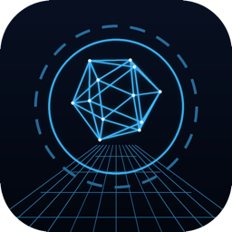

<p align="center">
  
</p>

<h1 align="center">HoloStage / 全息舞台</h1>

<p align="center">
  <b>中文</b> | <a href="#english">English</a>
</p>

<p align="center">
  
  
  
  
</p>
<p align="center">
  
  
  
  <a href="https://github.com/hwl513782273/HoloStage/releases/latest"></a>
</p>

---

<p align="center">
  <a href="https://github.com/hwl513782273/HoloStage/releases/latest">下载最新版 / Download</a>
  ·
  <a href="https://github.com/hwl513782273/HoloStage/issues">问题反馈 / Issues</a>
</p>

> 把任意 3D 模型摆上「数码世界全息舞台」的 macOS 原生查看器：全息环、扫描线、数码文字显影一站配齐，还内置本地自动绑骨，让无骨骼模型也能动起来，FBX / OBJ / STL / PLY / glTF / USDZ / MMD 一把抓。 / A native macOS hologram-stage viewer that puts any 3D model on a Digimon-style holo stage — holographic rings, scanlines and DigiCode text built in, plus a local auto-rigger that brings boneless models to life; loads FBX / OBJ / STL / PLY / glTF / USDZ / MMD out of the box.
>
> **作者 Author：banqiu** **许可证 License：MIT**（详见 LICENSE）。可自由使用、修改与再分发，须保留版权与许可声明。

## 中文

### 主要功能

- **全息风格渲染**：边缘发光 / 全网格两种模式任切，Bloom 辉光 + 动态扫描背景，一眼「数码兽进化现场」。
- **三层全息环 + 数据弧**：经典 / 数据弧等环模式可调，环上文字支持数码字形（DigiCode）/ 英文 / 希腊三选，颜色自由定制。
- **数码文字显影**：内嵌官方 DigiCode 字形字体，面板里输入即舞台显影，数字与汉字无字形时自动回退。
- **本地自动绑骨 AUTO-RIGGER**：无骨骼模型拖标记定关节（下巴→腕→肘→膝→裆，自动利用对称），一键生成 21 骨人形骨架并接入动画全链路，全程本地不联网。
- **骨骼 / 姿态 / 关键帧**：点选骨架拖动、三轴微调、打关键帧、动作播放与导出，配套「关闭动画」开关与文件级 ibm 自适应，rest≠bind 的模型也能播。
- **导出一把梭**：GIF 动画、PNG 帧序列、当前帧 PNG、单文件网页 HTML 查看器，导出画面可叠加 HUD（四角括号 / 扫描线 / 数码文字显影）与右下角标题徽章。

> **平台说明 Platform Note：本工具为 macOS 原生应用（Swift + WebKit 壳 + Three.js 渲染层，打包为 `.app` / `.dmg`），暂无 Windows / Linux 版本。**

### 快速开始

1. 在 [Releases](https://github.com/hwl513782273/HoloStage/releases/latest) 下载对应系统的 DMG（见下方「macOS 版本选择」）。
2. 打开 DMG，把 `HoloStage.app` 拖入「应用程序」。
3. 首次打开：右键 → 打开（或终端执行 `xattr -dr com.apple.quarantine /Applications/HoloStage.app`）。
4. 点「打开模型文件」拖入模型，去「全息风格」切模式、「环模式」配全息环、「导出」出图。

从源码构建（需 macOS 12+ 与 Swift 工具链）：

```
git clone https://github.com/hwl513782273/HoloStage.git
cd HoloStage
./build.sh          # swiftc 直编 universal（x86_64 + arm64），产物 build/HoloStage.app
```

打包 DMG（需 macOS 自带 hdiutil）：

```
./make_dmg.sh       # 产物 12-HoloStage-<版本>-universal.dmg，输出目录可用 DMG_DIR 环境变量覆盖
```

### macOS 版本选择

- **Apple Silicon（M1 及更新）— 推荐**：下载 `12-HoloStage-1.3.5.19-beta-universal.dmg`（universal 双架构包，含 arm64 原生支持）。
- **Intel Mac**：同样下载 `12-HoloStage-1.3.5.19-beta-universal.dmg`（universal 包内含 x86_64 原生支持，无需 Rosetta）。

> 各档 DMG 均为 ad-hoc 签名、**未公证（notarized）**，首次打开请右键「打开」放行 Gatekeeper；最低要求 macOS 12.0 Monterey。各档均由同一套源码构建，源码零改动。

> 仓库「发行版 / Releases」的命名格式为：`支持最低版本-软件英文名-版本-架构`（如 `12-HoloStage-1.3.5.19-beta-universal.dmg`）。第一段数字为该包实际支持的最低 macOS 版本号。

### 支持的功能

| 类别 | 项目 | 说明 |
|------|--------|------|
| 模型格式 | FBX / OBJ / STL / PLY / glTF / GLB / USDZ / MMD | 拖入即载，OBJ 附带 TGA / DDS 贴图解码；ZIP 压缩包自动选主模型 |
| 全息渲染 | 边缘 / 全网格模式、线框、Bloom 辉光 | 硬边模式保留静态快照，动态线框走 GPU 蒙皮直接驱动 |
| 全息环 | ①②③ 三环独立配置 + 数据弧 | 环上文字三字形（数码 / 英文 / 希腊），中文与全角按码位确定性映射 |
| 动画 | 动画播放 / 循环模式 / 动作速度 | 支持骨骼动画、关键帧动作库，静态模型可本地自动绑骨后播放 |
| 场景 | 动态背景 / 自定义背景图 / WASD 平移 | 转速、动作速度可调，一键重置场景 |
| 导出 | GIF / PNG 帧序列 / 单帧 PNG / 单文件网页 HTML | 导出画面可叠加 HUD 四角括号、扫描线、数码文字显影与标题徽章 |

### 差异化亮点

- 🦴 **无骨也能动**：本地 AUTO-RIGGER 五步标记向导（下巴→腕→肘→膝→裆），无骨骼模型就地生成 21 骨人形骨架，全程不依赖 Mixamo 云服务。
- 🌀 **全息环三位一体**：三个全息环独立调参数，数据弧文字绕满整圈，数码 / 英文 / 希腊字形一键切换。
- 🔣 **官方 DigiCode 字形**：内嵌数码文字字体，输入即显影，中文全角按码位确定性映射、无字形自动回退。
- 🎞️ **导出即成品**：GIF、帧序列、单帧、单文件网页 HTML 四路导出，HUD 叠加层让导出画面自带「数码全息」氛围。
- 🧩 **格式全家桶**：FBX / OBJ / STL / PLY / glTF / USDZ / MMD / ZIP 一个不落，贴图解码内置，拿过来就开。
- 💯 **100% 离线**：Swift + WebKit 壳 + Three.js 全部本地内置，无任何联网依赖，装上即用。

### 已知限制

- 应用未公证（notarized），首次打开会被 Gatekeeper 拦截——并非应用损坏，右键 →「打开」或执行 `xattr -dr com.apple.quarantine /Applications/HoloStage.app` 放行即可。
- 部分骨骼动画片段存在「播放即碎」的蒙皮冲突，应用会自动试播过滤并把这类片段禁播——并非 BUG，是防止模型炸裂的保护机制。
- 自动绑骨面向人形模型设计，四足 / 多足等非人形骨架不在自动生成范围内，可走「关闭动画」纯静态展示。

## English

### Highlights

- **Hologram-style rendering**: switch between edge-glow and full-mesh modes, with Bloom and an animated scanline background — straight out of a Digivolution scene.
- **Triple holographic rings + data arcs**: classic and data-arc ring modes, ring text in DigiCode / English / Greek, fully recolorable.
- **DigiCode text**: bundled official DigiCode glyph font — type in the panel and it shows on stage, with deterministic full-width mapping and automatic fallback.
- **Local auto-rigger**: drop markers on boneless models (chin → wrist → elbow → knee → crotch, symmetry-aware), generate a 21-bone humanoid skeleton locally, wired into the whole animation pipeline — no cloud service involved.
- **Bones / pose / keyframes**: pick and drag bones, tri-axis nudging, keyframes, action playback and export, plus a per-file ibm adaptation so rest≠bind models play correctly.
- **Export everything**: GIF animation, PNG frame sequence, single-frame PNG, and a single-file web HTML viewer — with optional HUD overlay (corner brackets, scanlines, DigiCode) and a title badge.

> **Platform Note: this is a native macOS app (Swift + WebKit shell + Three.js rendering layer, packaged as `.app` / `.dmg`). There is no Windows / Linux build.**

### Quick start

1. Download the DMG for your system from [Releases](https://github.com/hwl513782273/HoloStage/releases/latest) (see "Choose a macOS build" below).
2. Open the DMG and drag `HoloStage.app` into "Applications".
3. First launch: right-click → Open (or run `xattr -dr com.apple.quarantine /Applications/HoloStage.app`).
4. Click "打开模型文件" to load a model, tweak modes under "全息风格", configure rings under "环模式", then export.

Build from source (requires macOS 12+ and the Swift toolchain):

```
git clone https://github.com/hwl513782273/HoloStage.git
cd HoloStage
./build.sh          # builds a universal binary (x86_64 + arm64) into build/HoloStage.app
```

Package the DMG (requires the built-in hdiutil):

```
./make_dmg.sh       # outputs 12-HoloStage-<version>-universal.dmg; override the folder with DMG_DIR
```

### Choose a macOS build

- **Apple Silicon (M1 and newer) — Recommended**: download `12-HoloStage-1.3.5.19-beta-universal.dmg` (universal build with native arm64 support).
- **Intel Mac**: download the same `12-HoloStage-1.3.5.19-beta-universal.dmg` (the universal build ships a native x86_64 slice, no Rosetta needed).

> All DMGs are ad-hoc signed and **not notarized**. Right-click → Open on first launch to pass Gatekeeper. Minimum macOS version is 12.0 Monterey. All variants are built from the same source with zero modification.

> Release naming format: `minimum-macOS-version-name-version-arch` (e.g. `12-HoloStage-1.3.5.19-beta-universal.dmg`). The leading number is the minimum macOS version the package supports.

### Supported features

| Category | Item | Description |
|----------|--------|-------------|
| Model formats | FBX / OBJ / STL / PLY / glTF / GLB / USDZ / MMD | Drag and drop to load; OBJ ships with TGA / DDS texture decoding; ZIP archives auto-pick the main model |
| Hologram rendering | edge / full-mesh modes, wireframe, Bloom | Hard-edge mode keeps a static snapshot; dynamic wireframe is GPU-skinned and animation-driven |
| Holo rings | three independent rings + data arcs | Ring text in three glyph sets (DigiCode / English / Greek), deterministic full-width mapping |
| Animation | playback / loop modes / action speed | Skeletal animation and keyframe actions; static models can be auto-rigged locally first |
| Scene | animated background / custom image / WASD panning | Adjustable spin and action speed, one-click scene reset |
| Export | GIF / PNG sequence / single frame / single-file web HTML | Optional HUD overlay: corner brackets, scanlines, DigiCode, title badge |

### Why this tool

- 🦴 **Boneless models come alive**: a five-step marker wizard (chin → wrist → elbow → knee → crotch) builds a 21-bone humanoid skeleton locally — no Mixamo cloud needed.
- 🌀 **Triple rings in one stage**: three independently tuned holo rings, data-arc text wrapping the full circle, one-click glyph switching.
- 🔣 **Official DigiCode glyphs**: embedded font, type-to-reveal, deterministic CJK mapping with automatic fallback.
- 🎞️ **Exports that look finished**: GIF, frame sequence, single frame and single-file web HTML, all with optional HUD overlay for that holo vibe.
- 🧩 **Every format on deck**: FBX / OBJ / STL / PLY / glTF / USDZ / MMD / ZIP, textures decoded in-app — load and go.
- 💯 **100% offline**: Swift + WebKit shell + Three.js bundled locally, zero network dependency.

### Known limitations

- The app is not notarized, so Gatekeeper blocks the first launch — that is not corruption. Right-click → Open, or run `xattr -dr com.apple.quarantine /Applications/HoloStage.app`.
- Some skeletal clips suffer from "shatter on play" skinning conflicts; the app pre-plays and disables those clips automatically — a protective mechanism, not a bug.
- The auto-rigger targets humanoid models; quadruped and other non-humanoid rigs are out of scope — use the "关闭动画" (disable animation) switch for a pure static showcase.

## 隐私与安全 / Privacy and security

- 全部功能本地运行，模型文件不上传、无任何联网请求 / Everything runs locally: your model files never leave the machine, and the app makes no network requests.
- 仅使用系统沙箱内的标准文件选择器载入模型，过程完全透明可见 / Models are loaded through the standard system file picker; the whole process is visible on screen.
- 应用未公证（notarized），请仅从你信任的来源获取，并在首次打开时右键放行 / The app is not notarized — get it only from sources you trust and right-click → Open on first launch.

## 许可证 / License

> **MIT License** — 版权归 **banqiu** 所有（2026）。
>
> - 允许个人与商业免费使用、修改、再分发，须保留版权与许可声明。
> - 完整条款见 [LICENSE](https://github.com/hwl513782273/HoloStage/blob/main/LICENSE)。

## 支持 / Support

全息舞台是一款免费开源工具，基于 MIT 许可发布，离线、无广告。如果你觉得好用，欢迎在 GitHub 上点个 Star，或反馈问题 / 提交 PR 帮它变得更好 —— 纯自愿。 HoloStage is free, open-source, and ad-free. If it helps you, a GitHub Star or an issue/PR is warmly welcome — entirely optional.
